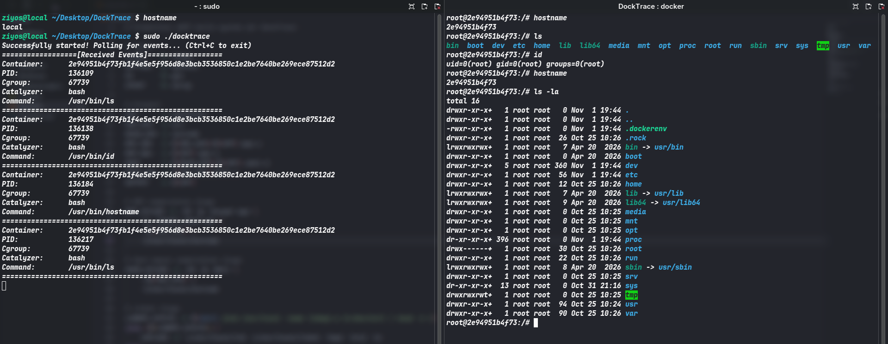

# DockTrace 🛡️


A lightweight Docker container command monitoring tool powered by eBPF. It tracks commands executed inside containers in real time and logs their activity for better visibility, monitoring, and security analysis.
By leveraging eBPF CO-RE (Compile Once – Run Everywhere) and kernel file handle resolution via open_by_handle_at(), Docktrace seamlessly maps low-level kernel events directly to their corresponding container IDs across diverse container runtimes (Docker, Podman, Containerd, Kubernetes CRI-O).

## ✨ Features
- ⚡ Zero Overhead Tracing: Uses eBPF tracepoints to intercept execution events directly inside the kernel.

- 🔍 Fast Container ID Resolution: Utilizes open_by_handle_at() to resolve cgroup_ids to full filesystem paths in constant time without scanning the /sys/fs/cgroup directory hierarchy.

- 🛡️ Escaping & Anomaly Detection: Easily differentiate between processes running inside an isolated container namespace and those running on the host system.

- 📦 Multi-Runtime Support: Detects container contexts across Docker, Podman (Rootful & Rootless) and Kubernetes (crio/containerd).

## 📸 Screenshot


## 🛠️ Architecture Overview

```
 ┌─────────────────────────────────────────────────────────┐
 │                      User Space                         │
 │ 1. Extract host namespace inode.                        │
 │ 2. Load BPF Bytecode via Libbpf.                        │
 │ 3. Send host namespace inode to eBPF code.              │
 │ 4. Receive Event via Ring Buffer.                       │
 │ 5. Convert cgroup_id -> cgroup path (open_by_handle_at).│
 │ 6. Extract Hex Container ID.                            │
 └──────────────────────────▲──────────────────────────────┘
                            │
 ┌──────────────────────────┴──────────────────────────────┐
 │                    Kernel Space                         │
 │ 1. eBPF Tracepoint Probes (execve)                      │
 │ 2. Extract Task struct, PID, Comm, & Namespace Inodes   │
 └─────────────────────────────────────────────────────────┘
```

## 📋 Prerequisites
Before building Docktrace, ensure your system meets the following requirements:
- **Linux Kernel**: `5.7+` (with `CONFIG_BPF=y` and `CONFIG_BPF_SYSCALL=y`).
- **Toolchain**: `clang`, `llvm`, `gcc`, `make`, `bpftool`.
- **Libraries**: `libbpf-dev`, `libelf-dev`, `zlib1g-dev`.
- **Permissions**: Root privileges (`sudo`).
### Debian/Ubuntu
```bash
sudo apt-get update
sudo apt-get install -y clang llvm gcc make bpftool libbpf-dev libelf-dev zlib1g-dev
```
### **Fedora / RHEL / CentOS**
```bash
sudo dnf install -y clang llvm gcc make bpftool libbpf-devel elfutils-libelf-devel zlib-devel
```
### Arch Linux
```bash
sudo pacman -S --needed clang llvm gcc make bpftool libbpf libelf zlib
```

## 🚀 Building & Running
### 1. Clone the Repository
```bash
git clone https://github.com/ziy0s/DockTrace.git
cd DockTrace
```
### 2. Compile Docktrace
```bash
make
```
### 3. Run Docktrace
```bash
sudo ./docktrace
```

## 📄 License
This project is licensed under the GPL-2.0 License (matching eBPF Kernel requirement standards).
